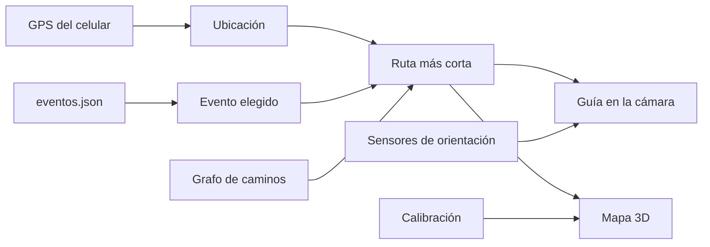

# De qué trata el proyecto

## En pocas palabras

Es una app para Android que lleva a una persona, caminando, hasta un evento dentro del campus de ESAN.
La persona elige el evento y sigue una guía dibujada sobre la imagen de su cámara (realidad aumentada), o mira la
ruta en un mapa 3D del campus.

## El problema que resuelve

Quien llega a un evento, sobre todo si no conoce el campus, tiene que orientarse entre varios edificios. Una
dirección o un punto en un mapa externo no dice por qué camino interno ir. La app calcula la ruta por los caminos
peatonales del campus y la muestra en el lugar donde está la persona.

## Para quién es

- **Asistentes y visitantes** que necesitan llegar a un evento.
- **Quien prepara la app**, que carga los eventos en un archivo, sin cambiar código.

## Cómo se usa

1. Al abrir la app se dan los permisos de cámara y ubicación.
2. Se elige el evento. Si solo hay uno, la app lo toma como destino.
3. Con la **cámara** se sigue la guía azul sobre el suelo; la tarjeta inferior indica el giro, la distancia y el
   tiempo a pie.
4. Con **Ver mapa** se ve el campus en 3D o en plano, con el evento, la propia ubicación y la ruta.
5. Al acercarse lo suficiente, la app avisa que se llegó al evento.

El botón «?» explica estos pasos dentro de la app.

## Qué incluye

| Función | Qué hace |
| --- | --- |
| Guía en la cámara | Dibuja el camino sobre el suelo y, si queda fuera del encuadre, una flecha indica hacia dónde girar. |
| Mapa 3D | Modelo del campus con giro, desplazamiento, zoom y vista superior. Está incluido en la app: no abre ninguna web. |
| Rutas | Busca el camino más corto en un grafo de 154 puntos y 189 uniones. |
| Eventos | Lista con nombre, fecha y distancia. |
| Ubicación | Distingue si la persona está dentro o fuera del campus y si el GPS es fiable. |
| Marcadores | Al reconocer la pileta con la cámara aparece Chuwi. Es una prueba. |
| Avisos | Explican qué falla (ubicación apagada, sin permiso, señal débil) y, cuando se puede, ofrecen un botón para resolverlo. |

## Cómo funciona



- **Ubicación y ruta:** el GPS da la posición y el algoritmo A\* busca el camino más corto hasta el evento.
- **Guía:** se coloca con el GPS y los sensores de orientación. Vuforia abre la cámara y reconoce los marcadores,
  pero no posiciona la guía.
- **Mapa:** una calibración convierte cada coordenada geográfica en un punto del modelo 3D.

## Tecnologías

| Tecnología | Uso |
| --- | --- |
| Unity 6 (`6000.6.0f1`) con URP | Motor de la app |
| C# | Lógica e interfaz |
| Vuforia Engine 11.4.4 | Cámara y reconocimiento de marcadores |
| Blender | Conversión del modelo del campus |
| .NET 8 | Pruebas de la lógica fuera de Unity |

## Cómo cambiar los eventos

Se editan en `Assets/Esan/Resources/Datos/eventos.json` y se vuelve a compilar la app:

```json
{
  "eventos": [
    { "nombre": "Nombre del evento", "fecha": "28 nov, 10:00", "coordenadas": [-76.9611597, -12.1057695] }
  ]
}
```

Las coordenadas van como **longitud, latitud**, al revés de como las muestra Google Maps. `fecha` es opcional.

## De dónde viene

El proyecto empezó como el mapa web del campus (`esan-mapa`). De ahí se pasaron a C# las rutas y la navegación. El
modelo 3D y su calibración vienen de la versión en Godot (`esan-godot`). Ahora todo se ejecuta en Unity.

## Estado actual

Funcionan en un Galaxy A15 la cámara, la lista de eventos, la carga del mapa, el pin, la ruta en el mapa y los
avisos de ubicación.

Limitaciones:

- Los dos eventos cargados son **de prueba**, con nombres y horarios inventados.
- Los eventos van dentro de la app: cambiarlos obliga a compilar e instalar de nuevo.
- La posición depende del GPS, que pierde precisión en interiores y junto a edificios.
- El modelo del campus está encajado de forma visual y aproximada, no con mediciones topográficas.
- Solo se ha probado en Android.

Pendiente:

- Recorrer el campus para comprobar que la guía coincide con los caminos reales.
- Cargar los eventos definitivos.
- Reconocer pasadizos y entradas con Area Targets de Vuforia, que requieren escanear el lugar.

## Más información

- [`README.md`](../README.md): instalación, compilación y pruebas.
- [`Assets/Esan/LEEME.md`](../Assets/Esan/LEEME.md): detalle técnico de cada script y heurísticas de usabilidad.
